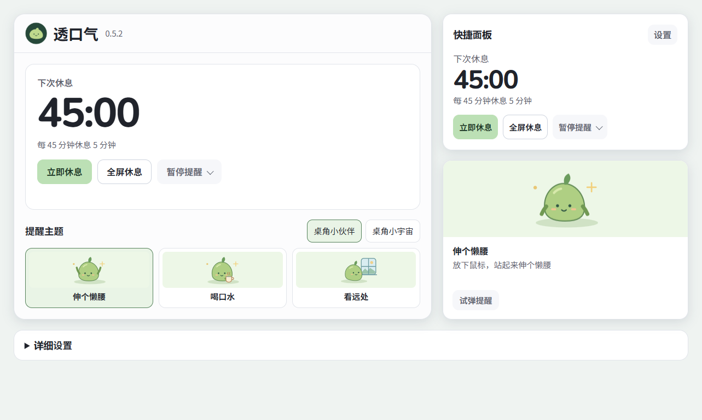
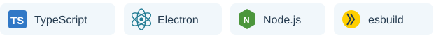

  

喜欢折腾前端、AI 和能让生活轻松一点的小工具。边学边做，把想法变成可以体验的作品。

## 正在打造

### 🌿 [透口气 · Rest Reminder](https://github.com/pink-mimi/rest-reminder-releases)

给一忙起来就忘了起身的你，一个安静的桌面休息提醒。

- **Windows 桌面工具**：工作与休息时长可调整，到点在屏幕一角轻轻提醒。
- **按自己的节奏来**：可以稍后提醒、暂停，或主动进入全屏休息。
- **无需注册**：设置保存在本机，支持明亮、暗黑和减少动态效果。

[下载试用](https://github.com/pink-mimi/rest-reminder-releases/releases/latest) · [使用说明](https://github.com/pink-mimi/rest-reminder-releases#readme) · [反馈问题](https://github.com/pink-mimi/rest-reminder-releases/issues/new/choose)

## 最近探索

| 🧭 前端与交互 | 🪄 AI 与自动化 | 🛠️ 硬件小实验 |
| --- | --- | --- |
| 页面、组件与有趣的动效 | 编程助手、Skills 与实用工具 | ESP32 与 AI 聊天机器人 |
| [前端开发与设计](https://github.com/stars/pink-mimi/lists/%E5%89%8D%E7%AB%AF%E5%BC%80%E5%8F%91%E4%B8%8E%E8%AE%BE%E8%AE%A1) | [AI 编程技能](https://github.com/stars/pink-mimi/lists/ai-%E7%BC%96%E7%A8%8B%E6%8A%80%E8%83%BD) | [小智 ESP32](https://github.com/78/xiaozhi-esp32) |

## 项目中用到

## 我的收藏航线

[AI 工具](https://github.com/stars/pink-mimi/lists/ai-%E5%B7%A5%E5%85%B7) · [AI 视频](https://github.com/stars/pink-mimi/lists/ai-%E8%A7%86%E9%A2%91) · [AI 编程技能](https://github.com/stars/pink-mimi/lists/ai-%E7%BC%96%E7%A8%8B%E6%8A%80%E8%83%BD) · [DeepSeek 插件生态](https://github.com/stars/pink-mimi/lists/deepseek-%E6%8F%92%E4%BB%B6%E7%94%9F%E6%80%81) · [前端开发与设计](https://github.com/stars/pink-mimi/lists/%E5%89%8D%E7%AB%AF%E5%BC%80%E5%8F%91%E4%B8%8E%E8%AE%BE%E8%AE%A1) · [面试与知识体系](https://github.com/stars/pink-mimi/lists/%E9%9D%A2%E8%AF%95%E4%B8%8E%E7%9F%A5%E8%AF%86%E4%BD%93%E7%B3%BB)

把值得研究的工具和项目分类收藏，留作下一次探索的起点。

---

慢慢探索，认真做点有用的东西。 ⛵
