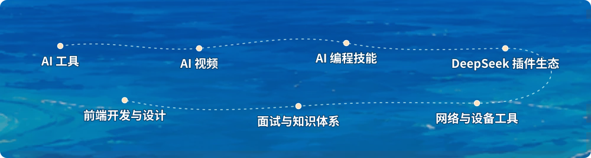

  

喜欢折腾前端、AI 和能让生活轻松一点的小工具。边学边做，把想法变成可以体验的作品。

## 正在打造

### 🌿 [透口气 · Rest Reminder](https://github.com/pink-mimi/rest-reminder-releases)

给一忙起来就忘了起身的你，一个安静的桌面休息提醒。

- **Windows x64 试用版与 Apple 芯片 Mac 预览版**：工作与休息时长可调，到点在屏幕一角提醒。
- **按自己的节奏来**：可以稍后提醒、暂停，或主动进入全屏休息。
- **回看休息节奏**：查看今日工作与休息记录，以及近 7 天的趋势。设置和记录保存在本机。

**v0.6.8（2026-11-27）**改善了后台计时和近 7 天记录的加载。关闭窗口后仍会提醒并保存工作记录。

[下载 Windows 或 Mac 版本](https://github.com/pink-mimi/rest-reminder-releases/releases/tag/v0.6.8) · [使用说明](https://github.com/pink-mimi/rest-reminder-releases/blob/main/INSTALL.md) · [反馈问题](https://github.com/pink-mimi/rest-reminder-releases/issues/new/choose)

## 最近探索

| 🧭 前端与交互 | 🪄 AI 与自动化 | 🛠️ 硬件小实验 |
| --- | --- | --- |
| 网页动效与跨平台原生界面 | 浏览器自动化、语音与视频创作 | ESP32 与 AI 聊天机器人 |
| [前端开发与设计](https://github.com/stars/pink-mimi/lists/%E5%89%8D%E7%AB%AF%E5%BC%80%E5%8F%91%E4%B8%8E%E8%AE%BE%E8%AE%A1) | [AI 编程技能](https://github.com/stars/pink-mimi/lists/ai-%E7%BC%96%E7%A8%8B%E6%8A%80%E8%83%BD) | [小智 ESP32](https://github.com/78/xiaozhi-esp32) |

## 项目中用到

## 我的收藏航线

[AI 工具](https://github.com/stars/pink-mimi/lists/ai-%E5%B7%A5%E5%85%B7) · [AI 视频](https://github.com/stars/pink-mimi/lists/ai-%E8%A7%86%E9%A2%91) · [AI 编程技能](https://github.com/stars/pink-mimi/lists/ai-%E7%BC%96%E7%A8%8B%E6%8A%80%E8%83%BD) · [DeepSeek 插件生态](https://github.com/stars/pink-mimi/lists/deepseek-%E6%8F%92%E4%BB%B6%E7%94%9F%E6%80%81) · [前端开发与设计](https://github.com/stars/pink-mimi/lists/%E5%89%8D%E7%AB%AF%E5%BC%80%E5%8F%91%E4%B8%8E%E8%AE%BE%E8%AE%A1) · [面试与知识体系](https://github.com/stars/pink-mimi/lists/%E9%9D%A2%E8%AF%95%E4%B8%8E%E7%9F%A5%E8%AF%86%E4%BD%93%E7%B3%BB)

[网络与设备工具](https://github.com/stars/pink-mimi/lists/%E7%BD%91%E7%BB%9C%E4%B8%8E%E8%AE%BE%E5%A4%87%E5%B7%A5%E5%85%B7)：代理、设备组网与局域网文件传输。

---

慢慢探索，认真做点有用的东西。 ⛵
